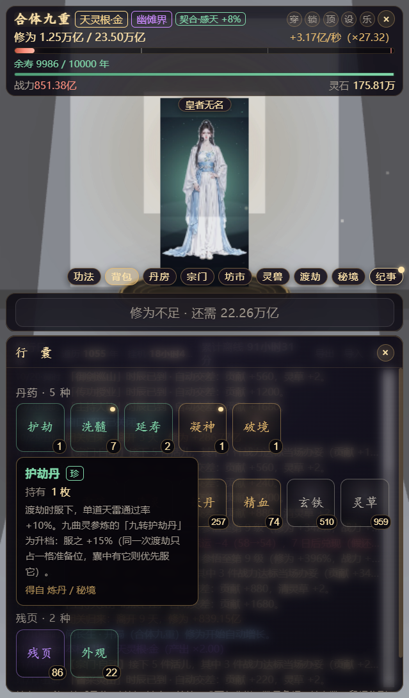
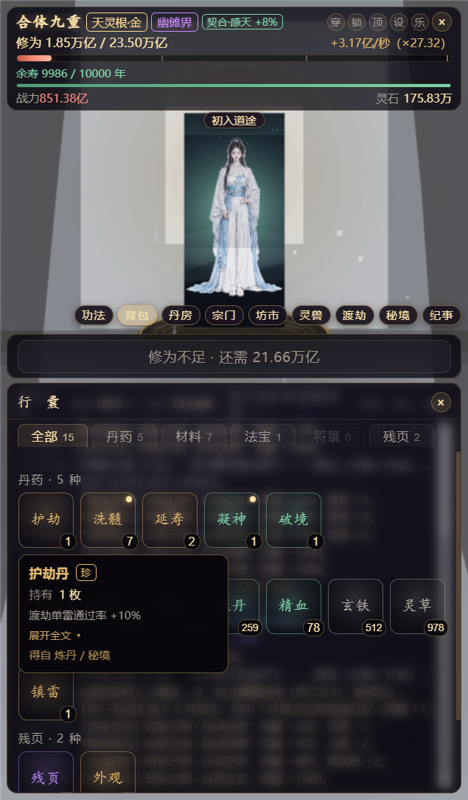
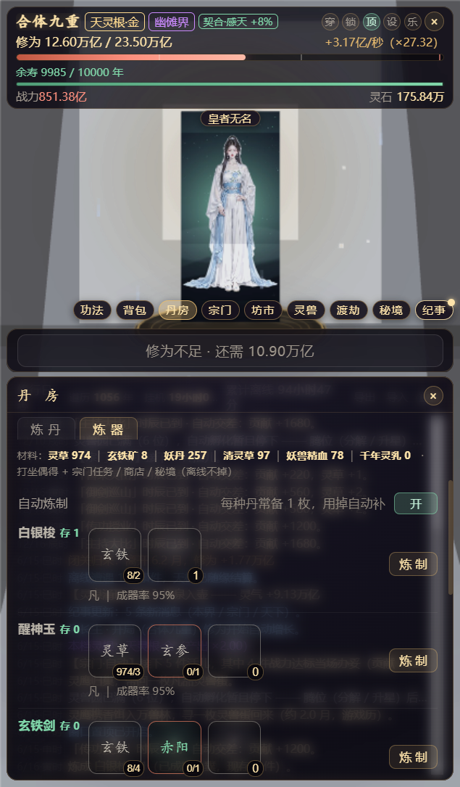

<div align=center>

<h1>问长生</h1>


<p>桌面右下角常驻的修仙挂机小窗 —— <b>打坐吐纳、突破渡劫、宗门坊市秘境灵兽，一窗全收</b>。<br>
十二界轮回 · 五百零四件物品 · 八道渡劫关口 · 转世与各界继承：挂机也能修出一条完整的道。</p>

</div>

## 支持平台

- Windows 10 及以上（x64）
- 安装版（NSIS）：可选安装目录，自动建桌面 / 开始菜单快捷方式
- 便携版（Portable）：单文件免安装，双击即用

## 屏幕截图

<table>
  <tr>
    <td align="center"></td>
    <td align="center"></td>
    <td align="center"></td>
  </tr>
  <tr>
    <td align="center"><sub>行囊 · 五类型图标网格</sub></td>
    <td align="center"><sub>行囊 · 类型页签与详情卡</sub></td>
    <td align="center"><sub>丹房 · 炼器页签</sub></td>
  </tr>
</table>

## 功能 / 开发计划

- [x] 打坐吐纳 · 离线产出与归来结算
- [x] 境界突破 · 渡劫八关口（招牌首通分界文案）
- [x] 十二界世界线 · 各界专属事件池
- [x] 宗门系统 · 12 界 96 宗 ＋ 288 本宗门功法
- [x] 功法库 · 每界可用 144 本
- [x] 坊市折扣店 · 境界分层拍卖行
- [x] 秘境洞天 · 22 座 / 66 档位槽
- [x] 灵兽 · 孵化 · 兽潮与大比
- [x] 物品库 504 条 · 行囊图标网格与类型页签
- [x] 丹房 · 炼器线
- [x] 转世与各界继承 · 换界散修化与职级八档
- [x] 世界纪事 · 成就 · 称号
- [x] 托盘常驻 · 鼠标穿透 · 开机自启 · 单实例锁
- [x] 存档原子写 ＋ 环形备份 ＋ 导入导出
- [x] GM 控制台（开发者调试）
- [ ] 更多内容持续开发中

## 下载

前往 [Releases](https://github.com/LzyJay/wenzhangsheng/releases/latest) 下载：

| 产物 | 说明 |
|---|---|
| `WenChangSheng-Setup-x.y.z-x64.exe` | 安装版（NSIS），推荐 |
| `WenChangSheng-Portable-x.y.z-x64.exe` | 便携版，单文件免安装 |

> 仓库不存放二进制包，安装包只走 Releases 附件，避免污染 Git 历史。

## 快速开始

### 直接使用

下载上面的安装包或便携版，双击运行即可。程序常驻托盘，关闭按钮只是收起而非退出。

### 从源码构建

需要 Node.js 22.7 及以上：

```bash
git clone https://github.com/LzyJay/wenzhangsheng.git
cd wenzhangsheng
npm install
npm run dev
```

常用命令：

| 命令 | 作用 |
|---|---|
| `npm run dev` | 开发模式（Vite HMR ＋ Electron 热启） |
| `npm run build` | 构建渲染层 `dist/` 与主进程 `dist-electron/` |
| `npm start` | 以实机窗口启动 |
| `npm run dist` | 打包 NSIS 安装版与便携版到 `release/` |
| `npm run gen:values` | 由 `data-source/` 的 CSV 重生成数值表 |

> 打包务必**先 `npm run build` 再 `npm run dist`** —— electron-builder 不会自动重建 `dist/`，否则会把旧产物打进包（历史上踩过一次）。

## 玩法速览

- **关闭按钮（×）** 不是退出，是藏进托盘，游戏继续跑；托盘双击唤回。
- **托盘菜单**：显示 / 隐藏小窗、回到右下角、显示存档文件夹、窗口三态（置顶 / 鼠标穿透 / 锁定位置）、开机自启、退出。
- **全局快捷键** `Ctrl+Alt+Q` 切换鼠标穿透（穿透后窗口「看得到、点不到」，这是紧急出口）。
- **设置面板**：暂停挂机、音量、化身、窗口三态、自动突破 / 寻蛋 / 孵化 / 炼制、氛围天气昼夜、皮肤、今日收益归因、GM 控制台（`Ctrl+Shift+G`）、存档管理。

## 存档与数据

存档固定写在**用户数据目录**，与安装位置无关，升级 / 覆盖安装 / 卸载都不丢档：

```
%APPDATA%\问长生\
├── save.json              主存档（唯一真源，原子写 ＋ 校验和）
├── save.bak ~ save.bak.5  环形备份（约 10 分钟一格，最远约 50 分钟前）
├── window-bounds.json     窗口位置记忆
└── …
```

设置面板 →「存档」页可导出 / 导入 JSON 备份，坏档可从环形备份逐格恢复。

## 性能与省电

- 窗口藏进托盘后**计时照跑**（后台不节流），DOM 刷新自动降到 5 秒一拍；
- 窗口可见但 2 分钟无人操作，画面自动降到 2 秒一拍省电，挂机产出分毫不变；
- 氛围系统帧率不足时自动降载（粒子减稀 → 停天气，恢复后升回）。

## Q&A

<details>
<summary>使用者 Q&A</summary>

#### Q：窗口为什么是一条竖着的无边框小窗？

A：设计如此。它常驻屏幕右下角，不抢焦点、不占桌面，需要时点托盘唤回。顶栏可拖拽、可缩放，下次启动回到上次位置。

#### Q：点关闭就找不到了，是不是退出了？

A：没有。× 只是藏进托盘，游戏继续跑。要真正退出请用托盘菜单 →「退出」。

#### Q：升级会丢存档吗？

A：不会。存档在 `%APPDATA%\问长生\`，与安装目录无关；旧档启动时自动补齐新字段，卸载时未勾选「删除用户数据」也会保留。

#### Q：为什么没有背景音乐？

A：仓库不附带任何音频。原素材为第三方商业唱片，版权不属于本项目，已在开源发布时移除。自行放入 `assets/bgm/*.mp3` 即可（详见 [assets/bgm/README.md](assets/bgm/README.md)）；没有音乐时程序只打一条日志，玩法不受影响。

#### Q：窗口发黑 / 透明失效怎么办？

A：个别显卡或驱动下透明窗口会发黑，给启动参数加 `--no-gpu` 禁用硬件加速兜底。

#### Q：托盘图标是空白？

A：确认 `assets/tray.png` 存在（可由 `python scripts/gen_icon.py` 重新生成）。

#### Q：能开两个窗口吗？

A：不能，已内置单实例锁；重复启动只会唤起已有小窗。

</details>

<details>
<summary>开发者 Q&A</summary>

#### Q：改数值要动哪里？

A：改 `data-source/72级数值表.csv`，再跑 `npm run gen:values` 重新生成 `src/data/realms.js`（生成物禁手改）。改平衡只动 `src/data/`。

#### Q：构建时报模块解析失败？

A：先确认 Node ≥ 22.7，再删 `node_modules` 重装。本项目为纯前端构建，不需要 Python / C++ 工具链。

</details>

## 开发

欢迎提交 PR。开工前建议先读 `docs/` 下的结构评估与进度看板，代码分层有硬约束：

| 目录 | 职责 |
|---|---|
| `src/main.js` | 唯一装配层（读档 → 实例化 systems → 装配 UI → 通知场景；`window.__wcs` 为调试出口） |
| `src/util/` | 零依赖叶子层（区间钳制、大数格式化、品质五档真源）；禁 import 业务层 / DOM / Phaser |
| `src/systems/` | 纯逻辑层（16 个玩法系统 ＋ `BonusLedger` / `EconLedger`）；禁 DOM / Phaser / 横向 import |
| `src/data/` | 纯配置层（改平衡只动这里；`realms.js` 为生成物禁手改） |
| `src/ui/` | 面板视图层（10 个 `*Panel.js`，只依赖 `data/` 与 `util/`） |
| `src/scenes/` `src/audio/` | Phaser 表现层 / 程序化音效引擎 |
| `electron/` | 主进程（窗口 / 托盘 / 存档 IO，无游戏逻辑） |
| `scripts/` | 工具链（数值生成 / 对账 / 图标 / MD→HTML / 起窗口） |
| `docs/` `design/` `data-source/` | 过程文档 / UI 交互稿 / 数值源 CSV |

版本号在 `package.json` 与 `src/systems/SaveSystem.js` 的 `APP_VERSION` 两处同步。

## 音乐素材

`assets/bgm/` 默认留空。程序通过 `import.meta.glob('../assets/bgm/*.mp3')` 静态收集该目录下的音频，放入任意 `.mp3` 并重新构建即可生效。请只使用你有权使用的音频。

## 致谢

- [Electron](https://www.electronjs.org/) —— 桌面窗口、托盘与主进程能力
- [Phaser](https://phaser.io/) —— 场景与渲染
- [Vite](https://vitejs.dev/) —— 构建与开发服务器
- [electron-builder](https://www.electron.build/) —— 安装包与便携包
- 所有在开发过程中读过、试过、否掉过的开源项目

## 许可

本项目基于 [MIT License](LICENSE) 开源，Copyright (c) 2026 问长生项目组。

游戏内的文字、数值与设定均为原创；不含任何第三方小说文本、音乐或美术资源。
