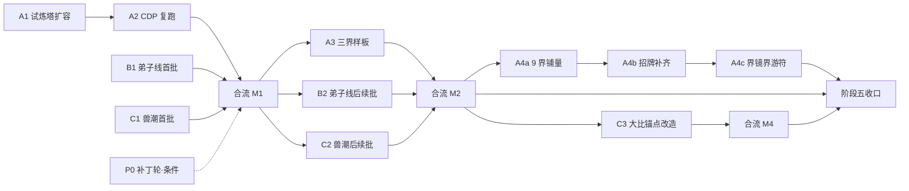

# 问长生 · 阶段五并行开发计划（V5.2~V5.6 + 工程债 + 合流）

> 生成：2026-09-19 ｜ 基线：代码版本 **5.1.0** ｜ 全量回归 **1975 项 / 40 份** ｜ git `95d6399`
> 配套文件：`进度看板-阶段五.md`（合流会话唯一维护）· `回执-模板.md`（业务会话产出格式）
> 本文件＝**可整篇丢进任何新对话的计划文档**；丢完再粘 §5 里对应任务的提示词即可开工。

---

## 0 · 怎么用这份文档

**三类会话，各司其职：**

| 会话 | 数量 | 干什么 | 用什么模型 |
|---|---|---|---|
| **业务会话** | 3（并行，一条车道一个） | 只写代码 + 只跑自己的自测 + 写回执 | 按任务规模分档（见 §2） |
| **合流会话** | 1（外部 AI 软件） | 取回执 → 串行合入 → 全量回归 → 升版本 → 回写文档 → 构建 → 提交 → 维护看板 | 强档，永不降档 |
| **主人** | —— | 每轮点验窗口、拍板、手验项 | —— |

**使用步骤：**
1. 新对话 → 把**本文件全文**粘进去；
2. 再粘 §5 里对应任务的那段提示词（一段就够，不要一次粘多个）；
3. 会话按提示词干活，最后产出代码 + 自测 + `回执-<任务ID>.md`；
4. 把回执交给**合流会话**（§6.5 的 K1 提示词）合入；
5. 看板（`进度看板-阶段五.md`）随时能看到每一项状态。

**一句话铁律**：业务会话**不 build、不起窗口、不改版本号、不改回归清单、不提交、不碰主人存档**——这些全是合流会话的活。

---

## 1 · 基线（V5.1 收口后）

| 项 | 值 |
|---|---|
| 代码版本 | `package.json` + `src/systems/SaveSystem.js → APP_VERSION` 两处均为 **5.1.0** |
| 全量回归 | **1975 项全绿 / 40 份**（`node tests/wcs_regress.mjs`，≈2s，支持 `--only <关键字>` / `--jobs N` / `--serial` / `--list`） |
| 版本钉 | 升版时必须同改的 **11 份**：`V3.5` / `V3.5.1` / `V3.5.2` / `V3.5.3` / `V3.5.4` / `V3.5.7` / `V3.5.8` / `V3.5.9` / `V3.5.10` / `V4.5` / `V4.7`（均在 `tests/`） |
| 已交付 | 阶段一~四全部 ✅；阶段五首批 **P5.1 招牌秘境接线** ✅（12 条洞天三态 + 首通/每轮/周轮换 + 积分商店 + 成就 4 条） |
| 仓库根 | `<项目根>\`（**git 仓库在这里**；开发册与工作区根 README 在仓库外） |
| 开发册（权威） | `<工作区根>\游戏开发\04-分阶段开发计划\问长生-开发计划.md`（同目录 `.html` 由 `python scripts\md2html.py <md> <html>` 生成） |
| 设计库 | `<工作区根>\设计库\` |

---

## 2 · 模型分档（已拍板）

| 档位 | 模型 | 只给这类活 | **绝不给** |
|---|---|---|---|
| **强档** | **DeepSeek-V4.1-Flash** | 新增系统、XL 任务、跨界铺规则、**合流会话** | —— |
| **中档** | **GLM-5.3-Flash** | 域内扩展（L）、照既定模板铺量、要读既有系统再改 | 从零设计系统 |
| **轻档** | **hy3** | **照单执行**：数据填充、版本钉批改、统计汇总、单点补丁 | 任何要设计决策的活；关键路径 |

**互换规则**：若实际是 GLM-5.3-Flash 更强，把「强档 / 中档」两个名字对调，其余不动（hy3 恒为轻档）。

**hy3 红线**：给 hy3 的任务卡必须写成「不用想就能照做」的清单（精确到文件与数值）。写不出这种清单 → 换中档。

---

## 3 · 轮次排班与依赖

| 轮次 | 强档 DS-V4.1-Flash | 中档 GLM-5.3-Flash | 轻档 hy3 |
|---|---|---|---|
| **第 1 轮**（并行 3 会话） | **B1** 弟子线首批 | **C1** 兽潮与大比首批 | **A1** 试炼塔 60→100 |
| **第 1.5 轮**（串行） | **A2** CDP 真机段复跑 | —— | —— |
| **合流 M1**（串行，等四条都完） | **M1** 合入 A1 / A2 / B1 / C1 | —— | —— |
| **第 2 轮**（并行 3 会话） | **A3** 世界专属机制三界样板（XL） | **B2** 弟子线后续批 | **C2** 兽潮后续批 |
| **合流 M2**（串行） | **M2** 合入 + 首次全线占比归因复核 | —— | —— |
| **第 3 轮**（A 车道内串行） | **A4c** 界镜 + 界游符换界 | **A4a** 其余 9 界铺量 | **A4b** 招牌补齐 +6 条 |
| **第 3.5 轮**（C 车道，等 M2） | **C3** 大比镜像锚点改造（V5.6.2） | —— | —— |
| **合流 M4**（串行） | **M4** 合入 C3（升 5.6.2） | —— | —— |
| **收口**（串行） | **MF** 阶段五收口 | —— | —— |
| **条件** | —— | —— | **P0** 招牌周期补丁轮（读数超标才做） |



**串行点只有三处**：① A 车道内 A1→A2→A3→A4a→A4b→A4c（同改 `worlds.js` / `dungeon.js` / `WorldPanel.js`）；② B、C 车道各自「首批→后续批」（C 车道为 C1→C2→C3）；③ 合流会话的合入动作本身。

---

## 4 · 任务总表（12 项）

| ID | 模块版本 | 车道 | 规模 | 模型档 | 前置 | 主要文件 | 状态 |
|---|---|---|---|---|---|---|---|
| **A1** | V5.1.2 | A 世界线 | S | 轻（hy3） | —— | `src/data/dungeon.js`（+ 面板文案/断言） | 未开工 |
| **A2** | V5.1.3 | A 世界线 | S | 中 | A1 | `tests/V2整合版-CDP烟测.mjs`、`V2.5-CDP.mjs`、`V2.10-CDP.mjs` | 未开工 |
| **B1** | V5.5 | B 宗门线 | L | **强** | —— | `src/data/sect.js`、`src/systems/SectSystem.js`、`src/ui/SectPanel.js` | 未开工 |
| **C1** | V5.6 | C 灵兽线 | L | 中 | —— | `src/data/beasts.js`、`src/systems/BeastSystem.js`、`src/ui/BeastPanel.js` | 未开工 |
| **A3** | V5.2 | A 世界线 | **XL** | **强** | A2 + M1 | `src/data/worldMechanics.js`(新)、`src/systems/WorldMechanicSystem.js`(新)、`src/ui/WorldPanel.js`(新)、`src/systems/WorldSystem.js` | 未开工 |
| **B2** | V5.5.1 | B 宗门线 | M | 中 | B1 + M1 | 同 B1 | 未开工 |
| **C2** | V5.6.1 | C 灵兽线 | M | 轻（照单执行） | C1 + M1 | 同 C1 | 未开工 |
| **C3** | V5.6.2 | C 灵兽线 | M | 中/强 | C2 + M2 | `src/data/beastWaves.js`、`src/systems/BeastSystem.js`、`src/ui/BeastPanel.js` | **已交付**（`回执-C3.md`）｜ 待 M4 |
| **A4a** | V5.2.1 | A 世界线 | L | 中 | A3 + M2 | `src/data/worldMechanics.js` | 未开工 |
| **A4b** | V5.4 | A 世界线 | S | 轻（照单执行） | A4a | `src/data/dungeon.js`、`src/data/worlds.js` | 未开工 |
| **A4c** | V5.3 | A 世界线 | M | **强** | A4b | `src/systems/WorldSystem.js`、`src/data/items.js`（追加）、`src/ui/WorldPanel.js` | 未开工 |
| **P0** | V5.1.1 | 补丁 | S | 轻 | 主人读数超标 | `src/data/dungeon.js` 一个常量 | 挂起 |

---

## 5 · 任务卡与提示词（逐项；**每段提示词配本文件全文一起粘**）

> 通用尾段（每段提示词已包含，不必重复粘）：
> **禁止**：不 build、不起实机窗口、不跑全量回归、不改版本号与版本钉、不改 `tests/wcs_regress.mjs`、不 git 提交、不碰主人存档（`%APPDATA%\问长生\save.json`）、不动装配层公共区（dom 表 / 主循环 / 启动时序）与 `index.html` 的 `:root` 色表。
> **必须**：只改本任务认领的文件；测试要写盘先 stub `window.__wcs.save.save`；完成后按 `回执-模板.md` 写 `回执-<任务ID>.md`；只跑自己的 `tests/<版本>-自测.mjs`。

---

### 5.1 A1 · 试炼塔 1~60 → 1~100 层扩容（V5.1.2 ｜ 轻档 hy3 ｜ S）

**任务卡（已核实，照此即可）**
- **目标**：`src/data/dungeon.js` 的 `TOWER.floors` 由 `60` 改 `100`，补齐新里程碑标签与数值，同步改既有断言。
- **影响面很小**（已查证）：面板与系统全部走 `TOWER.floors` **动态取值**，**没有硬编码的 60**；`DungeonPanel` 用的是 `tv.floors`；`towerMilestone(70)/(80)` 已有通用兜底文案「第 N 层里程碑」，60 层有专属标签 `外观「塔顶客」`。
- **已知数值事实（写进交付说明）**：满级 L72 基准战力 = `830153833056`；`towerPower(m) = 35 × 1.4^(m-1) × 1.15`；**满级基准战力可达上限 = 第 71 层**；`towerPower(100) ≈ 1.18e16`（约满级基准的 1.4 万倍）→ **第 72~100 层在满级基准战力下不可达**（功法/灵兽乘区可再推几层）。
- **默认处置（不要自行改数值）**：保留 100 层作为长线目标，**不动** `powerMul` / `powerGrowth`；在交付说明里给出「可达上限 / 不可达层数 / 三条建议（A 保留为长线 ｜ B 调 `powerMul` 让 100 层可达 ｜ C 按可达层数封顶）」交主人拍板。
- **文件认领**：`src/data/dungeon.js`、`src/ui/DungeonPanel.js`（若发现写死文案）、`tests/V2.7-自测.mjs`、`tests/V3.2.1-自测.mjs`、`tests/V5.1-自测.mjs`、**新增** `tests/V5.1.2-自测.mjs`。
- **验收**：`node tests/V5.1.2-自测.mjs` 全绿；`towerMilestone(100)` 非空；`TOWER.floors === 100`；既有 5 份自测不红。

```text
请执行《问长生-开发计划》阶段五工程债任务 A1：试炼塔层数 60 → 100 扩容（模块版本 V5.1.2）。
起点：上文《阶段五并行开发计划》§1 基线 / §4 任务总表 A1 行 / §5.1 任务卡（含已核实的数值事实）。
文件认领（只改这些）：
  src/data/dungeon.js
  src/ui/DungeonPanel.js（仅在发现写死「60」时改）
  tests/V2.7-自测.mjs · tests/V3.2.1-自测.mjs · tests/V5.1-自测.mjs（改层数相关断言）
  tests/V5.1.2-自测.mjs（新增）
要做的事：
  1. TOWER.floors 60 → 100；TOWER.milestonePoints 按 §5.1 默认补 70/80/90/100 四档（每 10 层一档，数值沿用 30 层口径的递增规律并在注释里写明来源）；
  2. 里程碑标签表补 70/80/90/100（70 层以上风格与既有 60 层「外观」档一致）；
  3. 算清「满级基准战力可达最高层」并写进回执（towerPower(m) 与 L72 战力均已给）；
  4. 新增 tests/V5.1.2-自测.mjs，断言：floors === 100、towerMilestone(70/80/90/100) 非空、towerCleared 上限收敛到 100、挑战第 100 层后 towerNextFloor() 返回 null。
禁止：改 powerMul / powerGrowth / 任何产出系数；build；起窗口；改版本号；提交。
交付：跑 node tests/V5.1.2-自测.mjs 并把「通过 N 项，失败 0 项」原文贴回；按 回执-模板.md 写 回执-A1.md
      （含「72~100 层不可达」的量化说明与三条建议）；给我三行交付说明。
```

---

### 5.2 A2 · 三套 CDP 真机段复跑 + 口径修正（V5.1.3 ｜ 中档 ｜ S）

**任务卡**
- **背景**：`V2整合版-CDP烟测` / `V2.5-CDP` / `V2.10-CDP` 三套在 V4.7 改过口径但**从未实跑**，属积压欠账。
- **目标**：在真机上跑通三套；红了改**测试口径**（不是改实现）；若抓到真 bug，可改对应 `src/`，但**必须在回执里单列申报**（属越界）。
- **启动**：先 `Get-Process electron | Stop-Process -Force`（单实例锁会把新启动并进旧进程）→ `cmd /c scripts\launch-debug.cmd`（起 9229）→ 用 node ≥22 跑（node 20 无全局 WebSocket）。
- **兜底**：若当前会话**无法起 Electron 窗口**，则只做**静态口径核对**（逐条读实现核对选择器 / `.ov` 清单 / 文案），把「实跑」明确列为主人手验项，不得谎报跑通。
- **文件认领**：`tests/V2整合版-CDP烟测.mjs`、`tests/V2.5-CDP.mjs`、`tests/V2.10-CDP.mjs`、**新增** `tests/V5.1.3-自测.mjs`（静态核对口径 + 实跑记录）、（仅在抓到真 bug 时）对应 `src/`。
- **验收**：三套各自贴出「通过 N / 失败 M」原文；`V5.1.3-自测` 里固化「`.ov` 清单 11 条与 `syncDragRegions`/Esc 链一致」这类静态不变量。

```text
请执行《问长生-开发计划》阶段五工程债任务 A2：三套 CDP 真机段复跑与口径修正（模块版本 V5.1.3）。
起点：上文 §5.2 任务卡 / §7 环境坑。
文件认领：tests/V2整合版-CDP烟测.mjs · tests/V2.5-CDP.mjs · tests/V2.10-CDP.mjs · tests/V5.1.3-自测.mjs(新增)
          （仅在抓到真 bug 时改对应 src/，并在回执里单列申报）
步骤：
  1. 清旧实例 → 起 launch-debug（9229）→ node(≥22) 跑三套；
  2. 红的先判断是「实现真 bug」还是「测试口径过期」：属过期就改测试（选择器 / 文案 / 结构断言），
     属真 bug 就改实现并在回执里单列；
  3. 新增 tests/V5.1.3-自测.mjs 固化三条静态不变量：① index.html 每个 .ov 都出现在互斥链与 Esc 链；
     ② .ov 总数 = 11；③ 三套 CDP 文件里用到的元素 id 都能在 index.html 找到。
禁止：为了绿而放宽断言；把「没真跑」写成「已跑通」；build；起窗口以外的进程管理；改版本号；提交。
交付：回执-A2.md 里贴出三套各自的通过/失败项数 + 每处口径改动的「原文 → 现文」；三行交付说明。
      若本会话无法起窗口，就在回执顶部写「仅静态核对，实跑交主人」。
```

---

### 5.3 B1 · 弟子线首批（V5.5 ｜ 强档 DeepSeek ｜ L）

**任务卡**
- **设计源**：`设计库\03-内容模块\宗门弟子v1.md`（＝设计库内容批次 2/3 宗门篇）。
- **范围（首批）**：收徒 → 培养 → 职权 → 贡献 四件事闭环；弟子只在 `state.sect` 子树内，**不新开存档根**。
- **开工前必做**：先用 `code-explorer` 子代理摸清宗门域完整文件面（`sect.js` 数据表 / `SectSystem` 子树与方法 / `SectPanel` 注入项 / 既有 `V2.4-自测` 断言口径），把结论写进回执开头。
- **要求**：数据先行（参数全放 `src/data/sect.js` 或新 `src/data/disciples.js` 并注释设计库出处）；产出**不发境界**；上线前后各出一次静态量级预估（宗门线目标 ≤15%，见开发册 §七）；归因走**既有** `sect` 线，**不新增线**。
- **文件认领**：`src/data/sect.js`（或新增 `src/data/disciples.js`）、`src/systems/SectSystem.js`（或新增 `DiscipleSystem.js`）、`src/ui/SectPanel.js`、`src/data/items.js`（**只追加表尾**）、`index.html`（仅宗门遮罩区块内）、`src/main.js`（**仅 2.4 宗门装配区块**）、**新增** `tests/V5.5-自测.mjs`。
- **验收**：收徒一名并可培养、职权可升、贡献可结算；老档（无新叶子）不炸；自测全绿。

```text
请执行《问长生-开发计划》阶段五模块 P5.5：弟子线首批（收徒 / 培养 / 职权 / 贡献）。车道 B（宗门线），模型档位：强。
起点必读：上文《阶段五并行开发计划》§1 基线 / §5.3 任务卡；开发册 §4.1b / §4.4（弟子行）/ §七（宗门线 ≤15%）/ §十三（并行规范）；
          设计库 03-内容模块\宗门弟子v1.md。
开工第一步：调用 code-explorer 子代理摸清宗门域文件面（数据表 / 子树 / 面板注入项 / 既有 V2.4-自测断言口径），
            把「可复用方法 + 需新增叶子 + 自测份数」结论写在你回复的开头。
范围：弟子线首批＝收徒 → 培养 → 职权 → 贡献 四件事闭环；只落在 state.sect 子树内，不开新存档根。
文件认领（只改这些）：src/data/sect.js（或新增 src/data/disciples.js）· src/systems/SectSystem.js（或新增 DiscipleSystem.js）
  · src/ui/SectPanel.js · src/data/items.js（只追加表尾，新段前加锚定注释）· index.html（仅 #sect-overlay 区块内）
  · src/main.js（仅「2.4 宗门 装配区」）· tests/V5.5-自测.mjs（新增）
硬口径：数据先行（参数全在 data 层并注释设计库出处）；产出不发境界，只给材料/货币/缓冲；
        归因走既有 sect 线，不新增归因线；新存档叶子模块自带 ensureXxx() 懒建兜底，不改 SaveSystem 迁移链；
        面板遵守两条铁律（系统一律 getter 注入；委托回调内自行取 system）。
量级预估：上线前给出「弟子线每小时产出量级 / 在宗门线占比」的静态估算，对照 §七 目标 ≤15%。
禁止：build；起窗口；跑全量回归；改版本号与版本钉；改 tests/wcs_regress.mjs；git 提交；碰主人存档；
      动装配层公共区（dom 表 / 主循环 / 启动时序）与 :root 色表；跨模块互相 import。
交付：只跑 node tests/V5.5-自测.mjs 并贴出「通过 N 项，失败 0 项」；按 回执-模板.md 写 回执-B1.md；
      给我三行交付说明 + 静态量级预估表。文档四件套先写你自己那份草稿，合流会话统一并入。
```

---

### 5.4 C1 · 兽潮与灵兽大比首批（V5.6 ｜ 中档 GLM ｜ L）

**任务卡**
- **设计源**：`设计库\03-内容模块\灵兽兽潮与大比v1.md`（＝内容批次 2/3 灵兽篇）。
- **范围（首批）**：兽潮周期（周期性来犯 + 抵御结算）+ 灵兽大比（周期性评比 + 排名奖励）；只在 `state.beast` 子树内。
- **可复用**：`pets[]`（含 `star` 星级）、主战 1 + 辅助位、`powerBonusPct`、`titlesById`；**不要另起灵兽数据源**。
- **开工前必做**：先 `code-explorer` 摸清灵兽域文件面，结论写进回执开头。
- **要求**：数据先行；产出不发境界；上线前后各出一次静态量级预估（灵兽线目标 5~8%）；归因走**既有** `beast` 线。
- **文件认领**：`src/data/beasts.js`（或新增 `src/data/beastWaves.js`）、`src/systems/BeastSystem.js`（或新增 `BeastWaveSystem.js`）、`src/ui/BeastPanel.js`、`src/data/items.js`（只追加）、`index.html`（仅灵兽遮罩区块）、`src/main.js`（仅 2.8 灵兽装配区块）、**新增** `tests/V5.6-自测.mjs`。
- **验收**：兽潮可触发并可抵御结算；大比可评分并可领排名奖励；老档不炸；自测全绿。

```text
请执行《问长生-开发计划》阶段五模块 P5.6：兽潮与灵兽大比首批（周期波次 + 抵御结算 + 大比排名奖励）。
车道 C（灵兽线），模型档位：中。
起点必读：上文《阶段五并行开发计划》§1 / §5.4 任务卡；开发册 §4.1b / §4.4（兽潮行）/ §七（灵兽线 5~8%）/ §十三；
          设计库 03-内容模块\灵兽兽潮与大比v1.md。
开工第一步：调用 code-explorer 子代理摸清灵兽域文件面（beasts.js 种类池 / BeastSystem 子树与方法 / BeastPanel 注入项 /
            既有 V2.8-自测断言口径），结论写在回复开头。
可复用（不要另起数据源）：pets[]（含 star）· 主战 1 + 辅助位 · powerBonusPct · 既有称号表。
文件认领（只改这些）：src/data/beasts.js（或新增 beastWaves.js）· src/systems/BeastSystem.js（或新增 BeastWaveSystem.js）
  · src/ui/BeastPanel.js · src/data/items.js（只追加表尾）· index.html（仅 #beast-overlay 区块）
  · src/main.js（仅「2.8 灵兽 装配区」）· tests/V5.6-自测.mjs（新增）
硬口径：数据先行；产出不发境界；归因走既有 beast 线；新存档叶子懒建兜底、零迁移；
        面板两条铁律；兽潮周期与既有每日刷新口径（gametime 的 refreshMs / periodKeyOf）同源，不另立时钟。
量级预估：上线后给出「灵兽线每小时产出的量级 / 占比」静态估算，对照 §七 5~8%。
禁止：build；起窗口；跑全量回归；改版本号与版本钉；改 tests/wcs_regress.mjs；提交；碰主人存档；动公共区；跨模块 import。
交付：只跑 node tests/V5.6-自测.mjs 并贴出结果；按 回执-模板.md 写 回执-C1.md；三行交付说明 + 量级预估。
```

---

### 5.5 A3 · V5.2 世界专属机制 · 三界样板（V5.2 ｜ **强档 DeepSeek** ｜ XL）

**任务卡**
- **设计源**：`设计库\04-增补与变更\设计增补v1.2.md`（＝内容批次 2/3 世界篇）；现成的口径文案就在 `src/data/worlds.js` 的 `exclusive` / `friction` 字段里。
- **首批三界**：
  - **青岚界**：核心＝「掌天瓶」催熟灵田（把 `mat_lingcao` 类材料/灵田加速）；摩擦＝伪灵根突破成本 +10%（已在 `rootCost` 生效，机制侧只做展示与联动）。另加「元婴后定期小天劫考核（过则得雷淬资源）」。
  - **青云古界**：核心＝「剑冢」法宝成长线（法宝成长/祭炼，产出与战力微加成）；摩擦＝无飞升（终局改「剑意超脱」，本轮只做标记与展示）。
  - **望族山河**：核心＝「家族职权」（族贡换资源：族贡→资源兑换，职级越高额度越大）；摩擦＝族贡抽成 10%（产出上缴，机制侧必须**可开关可见**）。
- **必须处理的结构问题（已查证）**：现在 `#world-overlay` **只在开局抽世界用**（`data-state="intro"/"result"`），没有日常世界面板。默认走 **方案①：「给 `#world-overlay` 加一个日常态 `data-state="daily"`」，不新增遮罩（`.ov` 仍 11，不动公共区）**；若要新增 `#world-daily-overlay`（`.ov` 11→12），属公共区变更，必须在回执里**申报**并说明需同步改烟测结构核对。
- **存档**：`state.world.specialState` / `state.world.frictionState` **两叶子 V2.9 已预留**，直接懒建使用，**零迁移**。
- **数值护栏**：世界机制若产灵石/材料，**必须**给静态量级预估（照 V5.1 开发册 §6.3「归因口径复核报告」的做法：算每小时当量 → 折灵石 → 与派遣线/秘境线对比）；产出不发境界。
- **文件认领**：**新增** `src/data/worldMechanics.js`、**新增** `src/systems/WorldMechanicSystem.js`、**新增** `src/ui/WorldPanel.js`、`src/systems/WorldSystem.js`、`index.html`（世界遮罩区块 / 新增日常态）、`src/main.js`（世界装配区 + 新增面板装配行；**dom 表属公共区，动则登记**）、`tests/V3.4-自测.mjs` / `tests/V3.5-CDP.mjs`（仅在因日常态影响其归一化时改）、**新增** `tests/V5.2-自测.mjs`。
- **验收**：三界的「核心 + 摩擦」各自可开、有可见效果、可被面板读到；切界后行为按新界口径；老档（无新叶子）不炸；自测全绿。

```text
请执行《问长生-开发计划》阶段五模块 P5.2：各世界专属机制 · 首批三界样板。车道 A（世界线），模型档位：强。
起点必读：上文《阶段五并行开发计划》§1 / §3（A 车道串行点）/ §5.5 任务卡；开发册 §4.1b / §4.4（世界专属机制行）/ §七 / §十三；
          设计库 04-增补与变更\设计增补v1.2.md；既有 src/data/worlds.js 的 exclusive / friction 字段原文。
开工第一步：用 code-explorer 子代理摸清世界域文件面（WorldSystem 子树与方法 / #world-overlay 现有结构 /
            开局装配区在 main.js 的位置 / 既有 V2.9-自测断言口径），结论写在回复开头。再读设计增补 v1.2 取三界原文。
范围（首批三界，其余 9 界本轮不做）：
  青岚界＝掌天瓶催熟灵田 + 元婴后定期小天劫考核（过则得雷淬资源）；摩擦＝伪灵根突破成本 +10%（已有，做展示联动）
  青云古界＝剑冢法宝成长线（成长/祭炼，产出与战力微加成）；摩擦＝无飞升（仅标记与展示）
  望族山河＝家族职权（族贡换资源，职级决定额度）；摩擦＝族贡抽成 10%（必须可开关可见）
文件认领（只改这些）：src/data/worldMechanics.js(新) · src/systems/WorldMechanicSystem.js(新) · src/ui/WorldPanel.js(新)
  · src/systems/WorldSystem.js · index.html（世界遮罩区块 / 给 #world-overlay 加 data-state="daily" 日常态）
  · src/main.js（世界装配区 + 面板装配行；dom 表属公共区，动则在回执里显式申报）
  · tests/V3.4-自测.mjs 与 tests/V3.5-CDP.mjs（仅当日常态影响其归一化时）· tests/V5.2-自测.mjs(新增)
硬口径：
  · 界面结构默认走「#world-overlay 加日常态」，不新增遮罩（.ov 保持 11）；若要新增遮罩必须在回执里申报并说明同步改烟测。
  · 存档只用 state.world.specialState / frictionState（V2.9 已预留），懒建兜底、零迁移、不改 SaveSystem 迁移链。
  · 数据先行：三界参数全放 src/data/worldMechanics.js 并注释设计增补 v1.2 出处；WorldMechanicSystem 纯逻辑，
    禁 DOM/Phaser，禁 import 其他 system；跨模块只走 main.js 接线。
  · 面板遵守两条铁律（系统一律 getter 注入；委托回调内自行取 system）。
  · 产出不发境界；任何产灵石/材料的机制必须给「每小时当量 → 折灵石 → 与派遣线/秘境线对比」的静态量级预估。
禁止：build；起窗口；跑全量回归；改版本号与版本钉；改 tests/wcs_regress.mjs；提交；碰主人存档；动 :root 色表与主循环。
交付：只跑 node tests/V5.2-自测.mjs 贴出结果；按 回执-模板.md 写 回执-A3.md（含结构选择的申报、量级预估、9 界铺量的模板说明）；
      三行交付说明。9 界铺量（A4a）会照你定的模板做，请在回执里写清「新增一界要改哪几处」。
```

---

### 5.6 B2 · 弟子线后续批 + 宗门线归因（V5.5.1 ｜ 中档 ｜ M）

```text
请执行《问长生-开发计划》阶段五模块 P5.5.1：弟子线后续批 + 宗门线静态量级归因。车道 B，档位：中。
前置：B1 已由合流会话合入（版本 5.5.0），你是在既有框架内加内容，不要重构 B1 的形状。
范围：补弟子线的第二批内容（按设计库 03-内容模块\宗门弟子v1.md 的后续条目，取「收徒之外的经营/职级/事件」类），
      并出一次宗门线静态量级预估（含弟子带来的增量），对照开发册 §七 宗门线 ≤15%。
文件认领：src/data/sect.js（或 disciples.js）· src/systems/SectSystem.js · src/ui/SectPanel.js · tests/V5.5.1-自测.mjs(新增)
禁止：改 B1 已定的存档叶子名与语义；build；起窗口；跑全量回归；改版本号；提交；碰主人存档；动公共区；跨模块 import。
交付：只跑 node tests/V5.5.1-自测.mjs；按 回执-模板.md 写 回执-B2.md；三行交付说明 + 量级预估表。
```

---

### 5.7 C2 · 兽潮后续批 + 灵兽线归因（V5.6.1 ｜ 轻档 hy3 ｜ M ｜ **必须照单执行**）

> ⚠ hy3 只做执行。开工前请先让**中档/强档**会话（或 C1 会话）产出「改动清单」，把清单整块贴进下面的 `<改动清单>` 占位处。写不出清单就换中档模型。

```text
【照单执行卡 · 档位：轻】任务 C2：兽潮后续批（血脉觉醒 / 化形）+ 灵兽线静态量级归因（模块版本 V5.6.1）。
规则：只执行下面改动清单里的每一项，不得自行增删、不得改清单外的任何文件、不得自行放宽任何断言。
改动清单（由 C1 会话 / 合流会话产出后粘贴于此处）：
  <改动清单>
完成后：跑 node tests/V5.6.1-自测.mjs，把「通过 N 项，失败 0 项」原文贴回；红了原样上报，不要自作主张修改测试期望值。
回执：按 回执-模板.md 写 回执-C2.md（照单执行，逐条勾对清单；有偏差逐条注明）。
禁止：build；起窗口；跑全量回归；改版本号与版本钉；改 tests/wcs_regress.mjs；提交；碰主人存档；动公共区；改清单外文件。
```

---

### 5.8 A4a · 其余 9 界铺量（V5.2.1 ｜ 中档 ｜ L）

```text
请执行《问长生-开发计划》阶段五模块 P5.2.1：世界专属机制 · 其余 9 界铺量。车道 A，档位：中。
前置：A3（V5.2）已合入，src/data/worldMechanics.js 的「一界一个参数块」形状与 WorldMechanicSystem 的接口已定。
范围：把 A3 定下的模板套到其余 9 界（破晓星域 / 灯火人间 / 幽傩界 / 通天界 / 天工界 / 六面囚笼 / 九鼎九州 / 武元大陆 / 人间香火），
      每界「1 核心专属 + 1 摩擦项」，口径照 src/data/worlds.js 里该界的 exclusive / friction 原文。
起步：不要另起结构，照着 A3 在 src/data/worldMechanics.js 里已有的三界参数块追加；接口不一致就先在回执里提出，不要私自改接口。
文件认领：src/data/worldMechanics.js · src/systems/WorldMechanicSystem.js（仅补齐分支）· src/ui/WorldPanel.js（仅文案/行）
  · tests/V5.2.1-自测.mjs(新增)
要求：每界给一行「机制 → 产出量级」的静态预估，9 界汇总成表；产出不发境界；摩擦项必须可见可验证。
禁止：改 A3 已定的三界参数语义；build；起窗口；跑全量回归；改版本号；提交；碰主人存档；动公共区。
交付：只跑 node tests/V5.2.1-自测.mjs；按 回执-模板.md 写 回执-A4a.md（含 9 界一行一界的量级表）；三行交付说明。
```

---

### 5.9 A4b · 每界专属招牌补齐 +6 条（V5.4 ｜ 轻档 hy3 ｜ S ｜ **照单执行**）

> ⚠ 同样需要先有「改动清单」。清单由 A3/A4a 会话或合流会话产出（含 6 条招牌的 id / name / theme / source / unlockRealm / material / matPerH / 归属界），再贴进来。

```text
【照单执行卡 · 档位：轻】任务 A4b：补齐 6 条招牌洞天，让 12 界每界都有「本源洞天」（模块版本 V5.4）。
规则：只执行下面清单，逐条落实，不得自行增删、不得改清单外文件、不得改产出数值。
改动清单（先由强/中档会话产出后粘贴）：
  <改动清单>
要点（供核对，不要自行发挥）：
  · 现在 12 条招牌只覆盖 6 界为本源（青岚1 / 灯火5 / 青云1 / 通天1 / 六面1 / 九鼎3），另 6 界只领「游历洞天」；
    本次新增 6 条后，SIGNATURE_DUNGEONS 变 18 条，SIGNATURE_ORIGIN 里那 6 界的 local 改为 origin。
  · 新条目照既有条目的字段形状写全（id 用 sig_ 前缀且不撞已有 id；material 只能用现有 8 种材料之一）。
完成后：跑 node tests/V5.4-自测.mjs（新增），把结果原文贴回；红了原样上报。
回执：按 回执-模板.md 写 回执-A4b.md（逐条勾对清单，列出 18 条招牌的 界↔本源 对照表）。
禁止：改既有 12 条的数值与 unlockRealm；build；起窗口；跑全量回归；改版本号；提交；碰主人存档；动公共区。
```

---

### 5.10 A4c · 界镜道具 + 界游符换界（V5.3 ｜ **强档** ｜ M）

```text
请执行《问长生-开发计划》阶段五模块 P5.3：界镜道具 + 界游符换界。车道 A，档位：强。
起点必读：上文 §5.10；开发册 §4.4（界镜 / 界游符＝内容批次 2 世界篇）；设计库 04-增补与变更\设计增补v1.2.md；
          设计库 04-增补与变更\设计增补v1.1.md（若涉及气运/机缘）。
范围：① 界游符＝消耗品换界（重掷到另一界：世界修正、熟练度、专属机制一并切）；② 界镜道具＝预览/锁定目标界或记录界签（按设计增补原文定）。
      既有底子：WorldSystem 已有 freeRerollLeft / rerollCount / draw / reroll / assign，state.world 子树叶已预留。
文件认领：src/systems/WorldSystem.js · src/data/items.js（只追加表尾，新段前加锚定注释）· src/ui/WorldPanel.js（A3 新建的那个）
  · src/data/worldMechanics.js（仅当换界需要重置/迁移机制状态）· tests/V5.3-自测.mjs(新增)
硬口径：换界必须**原子**（世界修正 + 熟练度 + 专属机制状态一起切，不允许半生效）；
        熟练度沿用既有 MASTERY 口径（同界轮回 +3%/世、封顶 +15%）；物品只追加不改他人行；
        存档懒建兜底、零迁移；产出不发境界。
禁止：build；起窗口；跑全量回归；改版本号；提交；碰主人存档；动公共区（:root / 主循环 / dom 表未登记前）。
交付：只跑 node tests/V5.3-自测.mjs；按 回执-模板.md 写 回执-A4c.md（含「换界原子性」的自测证据 + 使用一件界游符前后的世界修正对照）；
      三行交付说明。
```

---

### 5.11 P0 · 招牌周期产出补丁轮（V5.1.1 ｜ 轻档 hy3 ｜ S ｜ **条件触发：仅当主人 24h 读数超标**）

```text
【照单执行卡 · 档位：轻】任务 P0：招牌秘境「每轮探取」产出降档补丁（模块版本 V5.1.1）。
触发条件：主人挂满 24h 后看设置面板「今日收益归因」，招牌线（dungeon 线）超过开发册 §七 上限 30% → 才做本任务。
要改的只有一处：
  src/data/dungeon.js 的 SIGNATURE.cycleHPer，由 1.2 改为 <主人在此填新值；建议 0.2 量级，先算再定>。
  （若主人同时决定压低首通，可一并改 firstClearBase / firstClearPer，但仍只改这一个常量块。）
连带：tests/V5.1-自测.mjs 里与招牌周期产出相关的断言按新系数同步（只改期望值，不放宽断言逻辑）。
完成后：跑 node tests/V5.1-自测.mjs + node tests/V5.1.1-自测.mjs（新增），贴出结果原文；重算并回报招牌线每秒/小时量级。
回执：按 回执-模板.md 写 回执-P0.md（含改前/改后量级对照表 + 建议是否还需要二次降档）。
禁止：改招牌数据表本身（18 条条目的 unlockRealm / material）；改其他产出系数；build；起窗口；改版本号；提交；碰主人存档。
```

---

### 5.12 C3 · 灵兽大比「同档镜像」锚点改造（V5.6.2 ｜ 中/强档 ｜ M）

> **背景（已实跑复核，2026-09-19）**：C1 首批的镜像公式 `npc = score × (1 − edge + spread × (2u − 1))`
> 判 `npc > score`，展开后 **`score` 被约掉** —— `⟺ u > (1 + edge/spread)/2 = 0.7667`，
> 单名 NPC 胜率恒 0.2333，`E[rank] = 1 + 15 × 0.2333 = 4.500`，**与编队强度完全无关**。
> 实测 8 档编队（40 → 605 分、跨度 15 倍）平均名次全为 **4.496 ~ 4.505**、进四强率全为 **52.2%**。
> 设计库 §2.3 的 5 档名次奖励表（4h/2.5h/1.5h/0.9h/0.4h，10 倍差）因此形同虚设 —— **养成对大比零反馈**。
>
> **改动清单已产出**：`改动清单-C3.md`（含逐字锚点代码、标定契约表、归因复核、7 处越界申报）。

```text
请执行《问长生-开发计划》阶段五模块 P5.6.2：灵兽大比「同档镜像」锚点改造（模块版本 V5.6.2）。
车道 C（灵兽线），档位：中/强。前置：C2（V5.6.1）已由 M2 合入（当前代码版 5.6.1）。
起点必读：改动清单-C3.md 全文（**清单 §3 的数值全部由 node 跑真实 contestScore() / 真实新公式得出，不要重新手算**）；
          设计库《灵兽兽潮与大比 v1》§2.1 / §2.2 / §2.3。
要解决什么：C1 首批的镜像锚点选成了「玩家自己的分数」，导致 score 在判据里被约掉、名次与编队强度无关。
            修法＝把 NPC 锚到「不依赖玩家的档位基准分」（随大境界递进），使编队强度真正决定名次。
范围（5 处，详见清单 §1/§2）：
  · src/data/beastWaves.js    —— CONTEST 换锚（删 spread/edge，加 span/swing/baseScore）+ contestBaseScore()
  · src/systems/BeastSystem.js—— contestEnter 换公式 + contestView 补 base/span
  · src/ui/BeastPanel.js      —— 大比悬停加「本届同档基准 N 分」
  · tests/V5.6-自测.mjs       —— 【越界申报】7 处大比断言随换锚同步（只改夹具与期望值，不放宽判定逻辑）
  · tests/V5.6.2-自测.mjs     —— 新增（8 节，约 90 项）
不做：不改 CONTEST.tiers 奖励表 / realmMul 档位系数 / contestScore() 评分公式；不细分档位粒度；
      不做真 percentile 分位；不碰兽潮线；不动公共区与存档结构（零迁移）。
要求：标定契约必须写成断言 —— 每档「中位编队 → 八强（第 6 名）」「满配编队 → 冠军/亚军」
      「起步编队 → 垫底（第 16 名）」，且**全档可夺冠**（否则 §2.3 的 4h 冠军档成死档）。
      归因：用真实 contestClaim() 重算三情景占比（**原预期「移动 < 0.2 个百分点，不越 §七 8% 带」已被实测推翻**，
            见下方「交付」块；口径更正为「旧版本就超带，换锚是中位改善 / 满配恶化」）。
禁止：build；起窗口；跑全量回归；改版本号与版本钉；改 tests/wcs_regress.mjs；提交；碰主人存档；动公共区；改清单外文件。
交付：只跑 node tests/V5.6.2-自测.mjs 与 node tests/V5.6-自测.mjs（两份都要绿）；按 回执-模板.md 写 回执-C3.md
      （§4 填三情景占比；越界申报 7 处逐条；§5 原样搬入清单 §6 的 5 条待拍板）；三行交付说明。
```

> **交付（2026-09-18，业务会话）**：已落地，`回执-C3.md` 已交。`tests/V5.6.2-自测.mjs` **80/0**、`tests/V5.6-自测.mjs` **75/0**。
> 实际改动 7 个文件（清单外 1 个：本计划文档的挂单动作 + `改动清单-C3.md` §4 就地更正块）。
> 自测实际 **9 节 80 项**（清单预估「8 节约 90 项」，多出 ⑨ 归因分化节）。
>
> **⚠ 一个必须主人拍板的越界发现（回执-C3 §4.3）**：清单 §4 的 `0.144 h/日` 大比锚点**低估 3.95×**
> （① 漏乘 `realmMul[6] = 3.0`；② 把名次当 1..16 均匀分布，真实是 `Binomial(15,0.2333)+1`）。
> 三情景真实读数：**日常 5.58% ｜ 中游 7.00% ｜ 终局上界 11.57% ❌**；而**旧版同口径是 7.02 / 8.44 / 9.45**，
> **三个情景在 C3 之前就全部超 §七 8% 带**。换锚的实际效果是「中位玩家 −1.44 pp 改善、满配玩家 +2.12 pp 恶化」。
> 本批按清单 §5 未动 `tiers` / `realmMul`，已升级为 **回执 §5 第 6 条**待拍板（三条更正路径与量级已给出）。
> **M4 合流前请先看这一条**。


---

## 6 · 合流框架（外部合流会话用）

### 6.1 角色与职责

合流会话是**唯一**有权做这些事的地方：改版本号、改 11 份版本钉、改 `tests/wcs_regress.mjs` 登记、跑全量回归、`vite build`、起实机窗口、git 提交、回写开发册与 README、维护 `进度看板-阶段五.md`。

### 6.2 回执规范（业务会话产出）

业务会话必须按 `回执-模板.md` 产出 `回执-<任务ID>.md`，含 6 节：① 改了哪些文件（新增标 NEW）② 自测结果原文 ③ 三行交付说明 ④ 静态量级预估（数值模块必填）⑤ 未做 / 风险 / 需拍板 ⑥ 合入建议（顺序、是否碰公共区）。
**缺回执或缺自测的模块不得合入**——记「阻塞」，跳过，继续下一个。

### 6.3 进度看板规范

`进度看板-阶段五.md` 由合流会话**唯一维护**（业务会话只读）。看板四节：任务进度表 / 轮次进度 / 待主人拍板与手验 / 变更日志。
状态取值只有六个：`未开工` · `进行中` · `待合入`（业务会话已交付且自测绿）· `已合入`（全量回归绿）· `已收口`（进版本 + 文档 + 提交）· `阻塞（写原因）`。
**每次合流结束后必须**：更新看板 → 在对话里贴出【进度快照】。

### 6.4 每轮合流固定动作（逐条做，不要跳）

1. **取件**：读该轮各任务的 `回执-<任务ID>.md`，核对文件清单与自测结果；缺件记「阻塞」；
2. **逐模块合入**（按认领序，一次一个）：跑该模块自测 → 跑**全量回归** → 绿才进下一个；红了先修再合；
3. **升版本**：`package.json` + `SaveSystem.APP_VERSION` 两处同步 + **11 份版本钉**同改；
4. **登记回归**：`tests/wcs_regress.mjs` 追加该模块自测行；
5. **文档四件套 + 基线总表**：§4.1b 模块表加行 → §6.x 交付笔记 → §4.3 验证一览（含合计）→ §12.2x 版本日志；书首基线总表同步；开发册 HTML 重生成（`python scripts\md2html.py <md> <html>`）；
6. **公共区登记**：§13.4⑤ 公共区变更登记表按实填；§13.2⑥ `__wcs` 键（不新增就写「未新增」）；
7. **README 同步**：`问长生\README.md` + 工作区根 `README.md`；
8. **构建与点验**：node 20 跑 `vite build` → 用 `dist/` mtime + 抽新标记验证落盘 → 清 electron 旧实例 → `scripts\launch.cmd` 起窗口交主人点验；
9. **提交**：不 amend、不强推；提交信息带模块号与本轮范围；
10. **更新看板 + 贴【进度快照】**。

### 6.5 合流提示词

**K0 · 初始化（只做一次）**

```text
你是本项目的「合流会话」（唯一职责：串行合入 + 回归 + 升版本 + 文档 + 构建 + 提交 + 维护进度看板）。
我已把《问长生 · 阶段五并行开发计划》全文给你（即上文）。请执行 K0 初始化：
1. 读开发册（<工作区根>\游戏开发\04-分阶段开发计划\问长生-开发计划.md）§一 基线总表，确认当前代码版本与回归基线；
2. 读 问长生\进度看板-阶段五.md（已由计划会话建好，含 11 项任务行），校验它是否与实际仓库一致（版本号 / 回归数 / git 最近提交）；
3. 跑一次全量回归（node tests/wcs_regress.mjs）记录基线数字，若与看板不符以实测为准并更新看板；
4. 打印【进度快照】并告诉我：当前有哪些任务可开工、分别该给哪个档位的模型、有没有阻塞项。
约束：本步只读 + 只更新看板，不改任何 src/、不改版本号、不提交。
```

**K1 · 每轮合流（可反复执行）**

```text
执行合流轮 <N>。本轮认领序：<A→B→C，按 §3 排班填>。
逐条做，不要跳：
1. 取件：读 问长生\回执-<任务ID>.md（本轮各任务），核对「改了哪些文件」与自测结果；
   缺回执或缺自测 → 看板记「阻塞」并写明原因，跳过该项继续。
2. 逐模块合入（一次一个）：跑该模块自测 → 跑全量回归 node tests/wcs_regress.mjs → 绿才进下一个；红了先修再继续。
3. 升版本：package.json + src/systems/SaveSystem.js 的 APP_VERSION 两处同步 + 11 份版本钉（V3.5 / V3.5.1~V3.5.4 / V3.5.7~V3.5.10 / V4.5 / V4.7）；
   版本号取开发册「版本号＝模块号」口径（如 V5.5 → 5.5.0）。
4. 登记：tests/wcs_regress.mjs 追加该模块自测行。
5. 文档四件套 + 基线总表：§4.1b 加行 → §6.x 交付笔记 → §4.3 验证一览（含合计）→ §12.2x 版本日志；
   书首基线总表同步；开发册 HTML 用 python scripts\md2html.py 重生成。
6. 公共区登记：§13.4⑤ 变更登记表按实填；§13.2⑥ 写「未新增键」或登记新键。
7. README 同步：问长生\README.md + 工作区根 README.md（版本号 / 回归项数 / 新增玩法）。
8. 构建与点验：node 20 跑 vite build（输出会被编辑器吞，用 dist mtime + 抽新标记验证）→ 清 electron 旧实例
   （Get-Process electron | Stop-Process -Force）→ cmd /c scripts\launch.cmd 起窗口，交主人点验。
9. 提交：git add -A 后提交，信息带模块号与本轮范围；不 amend、不强推。
10. 更新 问长生\进度看板-阶段五.md（状态列 / 版本 / 提交 / 回归数 / 变更日志），然后在对话里贴出【进度快照】。
约束：不改业务逻辑（只做合入与收口）；不碰主人存档 %APPDATA%\问长生\save.json；主人手验项（真机 72h / 安装卸载 / 占比实测）不由你代跑，只列进看板待办。
```

**K2 · 查进度（只读，随时可用）**

```text
只读模式：读 问长生\进度看板-阶段五.md，然后打印：
①【进度快照】全表（任务 / 车道 / 模型 / 状态 / 版本 / 提交 / 回归数）；
② 下一步该做什么（哪些任务可开工、各自该给哪个档位模型、各自的前置是否满足）；
③ 阻塞项与待主人拍板/手验项。
不要修改任何文件。
```

**KF · 阶段五收口**

```text
执行阶段五收口（MF）。前置：A4c / A4a / A4b 与 M2 全部完成。
步骤：
1. 全量回归（node tests/wcs_regress.mjs）→ 记录全绿数字；
2. 版本口径：<此值请主人当轮拍板；默认取 5.9.0 作为「阶段五终版」占位>——两处同步 + 11 份版本钉；
3. 开发册：§4.1b 阶段五模块总表全部改 ✅、§4.3 验证一览合计更新、§12.2f 新增「阶段五收口」版本日志、
   §4.4 未实装清单按实销账（招牌补齐 / 界镜界游符 / 世界专属机制 / 弟子 / 兽潮各自改状态）、书首基线总表全面回写；
4. §13.2⑥ / §13.4⑤ 按本轮实际改动回填；README 两处同步（版本 + 新增玩法清单）；
5. vite build 三产物 + dist mtime/标记抽验 → 清旧实例 → 起窗口交主人点验；
6. git 提交（不 amend、不强推）；
7. 更新看板，贴出【阶段五收口快照】：本阶段交付清单 + 回归总数 + 版本 + 主人手验项清单。
```

---

## 7 · 环境坑与常用命令（每个会话开工先看这段）

- **node 不在 PATH**：node 20 全路径 `%USERPROFILE%\.workbuddy\binaries\node\versions\20.18.0.installing.18348.__extract_temp__\node-v20.18.0-win-x64\node.exe`；另有 `C:\Program Files\nodejs\node.exe`（v24，跑自测 / 回归免 flag）。
- **构建只用 node 20**（新版会触发内联样式代理崩溃）；构建输出常被编辑器当 watch 吞掉 → **用 `dist/` 与 `dist/assets/index.js` 的 mtime + 抽新代码标记验证落盘**。
- **起实机窗口前先清旧实例**：`Get-Process electron | Stop-Process -Force`（单实例锁会把新启动并进旧进程，看到的是旧代码）；然后 `cmd /c scripts\launch.cmd`。
- **CDP 真机段**：`cmd /c scripts\launch-debug.cmd` 起 9229，用 node ≥22 跑（node 20 无全局 WebSocket）。
- **PowerShell**：会吞 `$`；无 bash；批量改文件要拼**绝对路径**；中文匹配用 `Select-String`（`.Contains('中文')` 会误报）。
- **归因台账**：`src/systems/EconLedger.js` 的线固定 8 条（`cult/offline/sect/dungeon/beast/event/breakthrough/other`）——**不新增线**。
- **值守口径**：系统「减弱动态」为开 → 动效断言按降级口径；毫秒时间戳禁用 `| 0`（用 `Number(x) || 0`）；大样本统计用定序随机。
- **常用命令**：`node tests/wcs_regress.mjs`（全量，≈2s）· `node tests/wcs_regress.mjs --only V5.5`（只跑受影响份数）· `node scripts/audit_values.mjs`（数值对账）· `npm run gen:values`（改数值后重生成）。

---

## 8 · 主人手验项（**不由任何会话代跑**，只列进看板待办）

- 真机 72h 长挂（P4.4 硬性验收项，历史上一直挂着）
- 安装 / 卸载实机回归（按 README 清单逐条走）
- 开机自启 / 托盘 / 拔显示器（OS 级行为）
- **§七 占比 24h 实测**：设置面板「今日收益归因」读数（这条决定 P0 补丁轮做不做）
- 每轮合流后：实机窗口点验新模块（合流会话起窗口，主人当场点）

---

## 9 · V5.1 挂起项（等读数）

| 挂起项 | 处理 |
|---|---|
| 招牌「每轮探取」吞吐疑超护栏（≈6.2~7.8 万灵石/小时，约为派遣线 62~78 倍） | **不动数值**，等主人 24h 读数；超标则做 **P0**（只改 `SIGNATURE.cycleHPer` 一个常量） |
| 突破奖励「降额保留 vs 彻底删除」 | 与上条同批拍板；若删，只动 `scripts/gen_values.mjs` 模板 + 重生成 + `audit_values` 对账 |
| CDP 三套真机段积压 | 已排为 **A2**（第 1.5 轮） |
| 每界专属招牌补齐 | 已排为 **A4b** |

---

## 附 · 任务 ID ↔ 内部计划 to-do 编号映射

| 本文档 | 内部计划的 to-do |
|---|---|
| A1 + A2 | `lane-a-debt` |
| B1 | `lane-b-disciple` |
| C1 | `lane-c-beasttide` |
| M1 / M2 / MF | `merge-wave-1` / `merge-wave-2` / `merge-stage5-close` |
| A3 | `lane-a-world-trio` |
| B2 | `lane-b-sect-wave2` |
| C2 | `lane-c-beast-wave2` |
| A4a + A4b + A4c | `lane-a-world-rest` |
| P0 | `patch-v51-1` |
